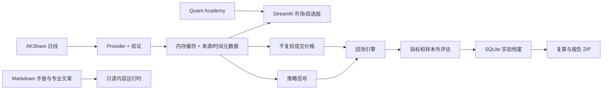

# 架构与数据流

## 模块化单体

桌面升级首批新增 `jobs.py` 和 `cpu_worker.py`：进程内有界 I/O 线程池、单个 CPU 调度器及独立计算子进程。任务按资料根目录、会话 ID、类型和输入指纹隔离，提交前复制输入，取消或超时后的晚结果丢弃；I/O 取消结束等待，已发出的请求仍可能完成并进入原有校验缓存。`ui_jobs.py` 只由 UI 提交、消费结果和轮询，不向工作者传入 Streamlit 状态。课程/手册独立 fragment，课程 fragment 同步当前 AI 白名单上下文。

CPU 使用专用标准输入输出协议启动受控内置函数，避免 Windows spawn 重放 Streamlit 的主脚本；窗口模式 Python 的空标准流有专门管道处理。桌面关闭先通过用户目录下每次启动唯一的停机信号清理 CPU 工作进程，再终止自己启动的服务；握手失败才对该 PID 的进程树执行兜底清理。协议不是网络 API，不接收用户上传 pickle 或任意代码。

价格曲线和 K 线采用 Streamlit 1.65 的惰性页签；研究图表的 `uirevision` 绑定当前查询，行情更新保持缩放，换查询重置。证券标签使用只读名称缓存，显式更新与新选择的名称查询在后台进行。后台重构不改变金融公式、SQLite schema 或实验指纹。

视觉层以 `theme.py` 的中性深色令牌和共享 CSS 为基础，Plotly 不导入 Streamlit。桌面服务启动时显式传递已批准主题，旧资料目录的配置文件保留。辅助面板总期望宽度超出可用空间时只显示最近主动打开的面板，宽屏恢复并排；DOM 监听限于顶栏与停靠容器，并兼容 Streamlit 更新期间的旧节点。学院维护既有整数课程索引和 AI 白名单，新增目录/搜索/前后课与教学图，解释支持惰性展开。市场概览的风险显示复用已有定义，独立纯函数提供短样本/无效值处理。

| 边界 | 当前模块 | 责任 |
| --- | --- | --- |
| Market Data | `market_data.py`, `data.py`, `refresh.py`, `names.py`, `securities.py`, `processing.py` | 代码与名称、可搜索目录、日线、查询隔离缓存、并发合并、失败保留及来源元数据 |
| Strategy | `strategy.py` | 用已知收盘价生成目标持仓信号 |
| Backtest | `backtest.py` | 下一开盘模拟成交、费用、滑点、交易限制与订单记录 |
| Analytics | `metrics.py`, `statistics.py`, `portfolio.py`, `research.py` | 风险收益、统计、组合、样本内外实验与指纹 |
| Learning | `learning.py`, `knowledge.py` | 八节固定样本参数实验与页面内知识解释；不记录任务、测验或进度 |
| Manual Content | `manual_content.py`, `ui_manual.py`, `docs/knowledge-drafts/` | 只读发现、严格校验、稳定 ID/分类/关联查询、离线搜索和完整阅读界面；不依赖 SQLite 或网络 |
| Storage | `storage.py`, `migrations.py`, `paths.py` | SQLite 版本迁移、备份、自选股、设置、实验和研究笔记；底层保留旧表名兼容 |
| AI | `deepseek.py`, `ai_chat.py`, `ai_research.py`, `ai_context.py`, `credentials.py`, `security.py` | DeepSeek 流式问答、可恢复中断、本地持久化会话、限定摘要、安全凭据和脱敏 |
| UI | `ui*.py`, `charts.py`, `app.py` | Streamlit 页面、文字手册预览与 Plotly 展示；不实现核心金融公式 |
| Desktop | `desktop_launcher.py`, `QuantLab.spec`, `installer/` | 本地服务、pywebview、PyInstaller 与 Inno Setup |

## 文字手册内容运行时

`manual_content.py` 从源码树或 PyInstaller 的资源根读取 `docs/knowledge-drafts/`，不依赖当前工作目录。它严格要求 10 篇登记手册和 85 篇专业文章，解析文章 frontmatter、核心解释、手册摘要、相关术语与 Markdown 正文，并在启动查询前验证必填字段、软件状态、重复 ID、分类及全部交叉引用。统一搜索结果包含类型、稳定 ID、分数、命中原因和解释片段；精确标题/别名、完整词、摘要、正文和有限次数的分词命中依次降权，同分优先专业文章并保持内容目录顺序。索引和排序完全在本地生成，不联网、不写用户资料库，也不导入 Streamlit。

`ui_manual.py` 接入全部 10 篇手册和 85 篇专业文章，提供三入口、手册目录、八类专业目录、离线相关度搜索、面包屑、状态说明和统一文章链接。滚动区顶部的固定工具栏只呈现当前分区下拉、搜索和上下文返回；结果默认显示 12 张双列卡片，每次再展开 12 项。搜索前目录/文章、查询、排序和展开数量都保存在会话状态中，返回时恢复。手册相关术语在加载阶段解析为稳定文章 ID 并校验，界面用可点击链接替代原静态列表。手册与 DeepSeek、研究笔记共用三面板停靠、排序、拖宽和最大化外壳。原新手使用指引的任务、路径、测验和进度代码已从文字手册分支删除，完整实现继续保留在 `codex/learning-center-v2`；schema v4 中的旧学习表和用户数据仍保留且不再写入。`QuantLab.spec` 把同一份只读 Markdown 资源带入未来的冻结应用，内容不会复制到用户资料库作为唯一来源。

## 数据合同

`data_quality.py` 为纯校验与离线日历报告，HistoryBundle新增可缺省quality、批次、许可和快照版本；不从页面读取时间推断新接收时间。`history_ranges.py` 处理日历年快捷范围，UI分开起止日期，手动编辑转自定义。历史缓存按资料根目录与规范查询隔离，入缓存前验证包身份字段、币种与OHLCV；失败保留旧数据并显示校验原因。`ui_data_quality.py` 只读取既有报告，不在重绘时重新计算日历。未完成日线的研究门槛为纯函数，供策略、回测及AI受控实验共用；日线收盘参考选择最后已结束记录。

`AKShareProvider`只对长区间原始价分段，30天重叠数值逐项一致才合并；复权请求整段获取。`research_inputs.py`强制获取复权/原始价/复权三次响应，检查当前图、前后复权、源身份与严格日期一致，产生独立输入清单，不更改原审计算法。该清单是获取一致性检查，不认证公司行动。

`source_rights.py` 的审核许可控制 `history_snapshots.py`。允许的完整响应经校验后，在SQLite v6保存不可变版本、质量/来源/接收时间/许可及内容校验，事务移动查询头；失败不覆盖旧版本。读取重新核验当前许可及数据/元信息校验。RefreshCache只恢复原成功时钟；手动强制检查仍访问上游。生产来源目前许可未知，不启用自动磁盘行情保存；教学数据验证完整路径。UI新增实验保存同样检查许可。既有低层save_experiment调用保留input_manifest=None兼容入口，由调用方保证其原有数据授权；当前UI总是传入新清单，旧档缺省为空，不被重新解释。

`MarketDataProvider.history(market, symbol, start, end, adjustment)` 返回经验证的 `HistoryBundle`：`date/open/high/low/close/volume/amount`、市场、规范代码、来源、币种、复权、接收 UTC 时间和缓存标记。A 股使用 AKShare 腾讯历史接口；港股以东方财富 `stock_hk_hist` 为主链路，传入明确日期区间，网络/API 异常时回退新浪 `stock_hk_daily`，并把回退写入 `source`，不隐藏来源切换。`snapshot` 当前由**最近历史日线收盘**派生，只有行情日期，没有已验证的盘中报价时刻；`received_at` 仅表示本机收到响应的时间。界面标注“历史日线；确切延迟未知”。未来授权适配器应返回独立的报价时间、时区、延迟状态与授权属性，不能把接收时间充当交易所时间。

历史缓存为 15 分钟、最多 64 个查询，快照缓存为 5 分钟；同查询并发合并，返回副本。市场页轮询按 5/10/15 分钟强制检查当前已加载查询和自选股；手动绕过对应缓存，5 秒防抖，不同快照请求至少间隔 1 秒。成功时间来自上游响应；缓存读取不更新它。失败保留旧值和时间并标明可能过期，不用演示值填充。自动更新限运行中的市场页会话。证券名称走独立基础信息服务，缓存 24 小时并持久化到证券资料表。

## 实验复现

回测读取同一交易日的信号价和不复权成交价，按日期严格对齐。信号由收盘形成，下一交易日开盘尝试成交。保存实验时，SQLite 压缩存储两份 CSV 快照和 SHA-256、参数、费用、市场、来源、接收时间、结果与研究笔记。复算从归档输入重新运行并核对实验指纹。ZIP 包含 Markdown 报告、两份行情 CSV 与 `assumptions.json`。

## 桌面与未来演进

桌面版沿用 `desktop_launcher.py` 启动仅监听 `127.0.0.1` 的 Streamlit 服务，pywebview 显示页面。首次启动通过“选择新的存放文件夹”和原生目录选择器创建结构化资料库；设置区分“当前资料库位置”与复制校验后的“迁移后的资料库位置”。默认位置只保留非敏感 `bootstrap.json` 指针。数据库、笔记附件、备份、日志、缓存和 WebView 数据进入活动资料根目录；`QUANT_LAB_DATA_DIR` 在测试中覆盖该流程。

V2 构建输出到 `dist/packages/<版本>/QuantLab`，manifest 保存 `payload_dir`，安装器和验收脚本读取同一目录。新版本不会清理正在运行的旧 `dist/QuantLab`；如果相同版本目录已有运行进程，构建预检停止，避免覆盖使用中的 payload。

下一阶段可实现授权报价 Provider（例如 Futu OpenAPI），并补足可验证的报价时间、许可证与限频契约；再评估 FastAPI 作为调用现有 Market Data、Backtest、Storage 服务的薄接口层。当前不需要微服务、React/Tauri 或实盘交易。SQLite schema 变更需版本化迁移，不能删除用户档案后重建。

## 迁移与 AI 边界

`PRAGMA user_version=5` 保留旧实验、行情 BLOB、自选股、名称、设置、学习记录与笔记附件，并新增 `ai_conversations` 和 `ai_messages`。会话按上下文作用域隔离，消息仅存最终回答与安全状态，不存 Key 或 `reasoning_content`。旧库先一致性备份，再在 `BEGIN IMMEDIATE` 事务中升级；失败回滚，原快照与指纹不重写。

`global_topbar` 提供使用手册、DeepSeek 和研究笔记入口。三个停靠面板支持调宽、排序和最大化，标题栏固定，正文独立布局。研究笔记恢复工作草稿；历史搜索匹配笔记和分类，点击笔记先进入渲染阅读页，实验、分类和回收站进入分步管理页。DeepSeek 聊天工具栏提供新对话与历史会话，消息列表独立滚动、输入区固定在底部；Enter 在控件提交后发送，Shift+Enter 换行。一次性待发送状态在消息区消费，流式消息分批写入 SQLite，重绘不会重复请求。最大化避开全局顶栏和可见左栏；非敏感面板宽度与顺序写入 WebView `localStorage`。

首次会话默认打开使用手册；用户关闭后不会在同一会话强制重开。设置兼容键 `learning_mode` 只控制解释密度；更改后在任何 fragment 渲染前消费一次性整页重绘标记。`render_knowledge_group` 默认显示前两项，可展开全部或收起。DeepSeek 打开时进入对话工作区，恢复当前作用域最近的本地会话；回答模式、事实摘要和快捷问题位于设置弹层，逐条复制和保存位于回答卡片。研究实验仍由独立按钮进入。数据库沿用旧 `learning_notes` 表名兼容已有笔记。

文字手册使用自动测试、隔离浏览器和实际 WebView2 三层验收。阶段 5 的 Browser 插件抽样覆盖全部 10 篇手册及跨八类、四状态的专业文章；本轮 ego-browser 进一步覆盖相关度卡片、展开、固定工具栏、术语直达和 DeepSeek 隐藏设置，WebView2 覆盖真实桌面 DOM、滚动、拖宽、排序、最大化和子进程清理。详细证据及未验证范围见 `docs/MANUAL_READING_ACCEPTANCE.md`。

`notes.py` 负责分类树、草稿、统一笔记/实验检索、回收站、附件验证和 ZIP 导出。历史选择先进入渲染阅读页；分类搜索使用原有含子分类查询。保存正式笔记后立即建立关联工作副本；附件按 SHA-256 在正式笔记与草稿间去重，界面合并显示历史重复记录。桌面桥接在校验资料库路径和 SHA-256 后可用 Windows 默认应用打开附件，或通过原生保存对话框把校验后的字节原子复制到用户选择的位置；浏览器模式继续使用 Streamlit 下载。图片 `attachment://id` 由受控组件显示。

股票选择用一个支持 `accept_new_options` 的搜索下拉框，代码和名称候选排序保持原样；未收录代码统一经过 `normalize_symbol`，无效输入禁用加载，市场切换保留各自选择。`securities.py` 提供市场隔离的目录：内置基础资料快照保证离线候选可用，显式更新取得新目录后原子写入 `user_data_dir()/securities/`。每份目录校验市场、规范代码、名称冲突、来源和带时区接收时间；失败保留原值。目录没有价格、币种换算或买入意见，名称字段不用于证明上市/可交易。`names.py` 独立查询东方财富基础资料，24 小时成功缓存、5 分钟失败冷却，手动名称更新绕过缓存且合并同查询并发，失败保留名称与原成功时间；不改写存档实验。

Key 只存在会话或 Win32 `CredWriteW/CredReadW/CredDeleteW` 管理的本应用凭据中；新会话在创建任何 Key 控件前自动执行一次 `CredReadW` 恢复。安全存储故障不会退回文件。异常信息不显示原始响应或带 Key 的传输异常；输出与研究笔记经过脱敏。测试用虚拟凭据和模拟 API；真实 API 最小验证由用户在软件内完成。

## 手册导航与教学

`ui_manual.py` 使用原生 Streamlit 控件维护纯会话内的目录、阅读位置、搜索来源和返回栈。搜索直接使用 `manual_content.py` 的确定性本地排名，不发送给 DeepSeek，也不写入 SQLite。内容加载或交叉引用校验失败时显示明确错误，不用演示文本替代。DeepSeek 会话消息以 `turn_id` 关联问题和回答；复制只发生在 WebView，逐条保存写入“问题 / DeepSeek 回答”Markdown。当前作用域至少两轮完成回答后才提供“总结并保存”，该按钮是单独的显式付费请求，最多使用最近 20 条同作用域消息，完整生成后才写笔记。

Quant Academy 继续调用 `learning.py` 的固定样本纯函数，并通过 `ui_knowledge.py` 跳转到对应手册文章。它不再保存教学实验、测验、目标或进度；原学习表仅为跨产品线资料库兼容而保留。

统计与 AI 实验页面现在提供实际模型/审计摘要；课程与指南提供类型明确的教学上下文。DeepSeek 研究/教学模式仍走同一客户端；白名单增加 `statistics`、`learning_context` 和 `answer_mode`，显式过滤练习答案、目标、笔记等。对话作用域涵盖数据、实验、课程/指南、教学参数、统计评价与回答模式，知识追问跨页携带点击时的白名单摘要并显示来源；更换查询或离开 AI 页后清除携带摘要。

AI 页暂时隐藏的密钥、模型和草稿控件使用显式会话保留，防止 Streamlit 页面切换清理；不把按钮状态加入保留集合。密钥仍只在内存或 Windows 凭据管理器中。
