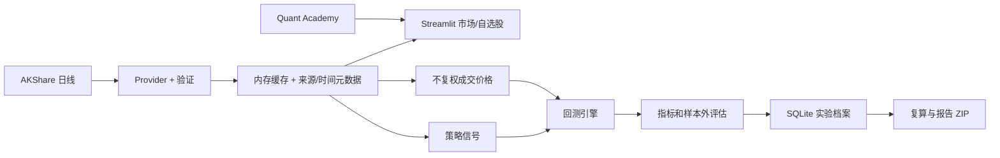

# 架构与数据流

## 模块化单体

| 边界 | 当前模块 | 责任 |
| --- | --- | --- |
| Market Data | `market_data.py`, `data.py`, `processing.py` | 代码规范化、Provider 协议、AKShare 日线、历史参考快照、数据验证、缓存与来源元数据 |
| Strategy | `strategy.py` | 用已知收盘价生成目标持仓信号 |
| Backtest | `backtest.py` | 下一开盘模拟成交、费用、滑点、交易限制与订单记录 |
| Analytics | `metrics.py`, `statistics.py`, `portfolio.py`, `research.py` | 风险收益、统计、组合、样本内外实验与指纹 |
| Learning | `learning.py` | 八节可手算课程和确定性参数实验 |
| Storage | `storage.py`, `paths.py` | 用户目录、SQLite 自选股与可复现实验档案 |
| UI | `ui*.py`, `charts.py`, `app.py` | Streamlit 页面与 Plotly 展示；不实现核心金融公式 |
| Desktop | `desktop_launcher.py`, `QuantLab.spec`, `installer/` | 本地服务、pywebview、PyInstaller 与 Inno Setup |

## 数据合同

`MarketDataProvider.history(market, symbol, start, end, adjustment)` 返回经验证的 `HistoryBundle`：`date/open/high/low/close/volume/amount`、市场、规范代码、来源、币种、复权、接收 UTC 时间和缓存标记。`snapshot` 当前由**最近历史日线收盘**派生，只有行情日期，没有已验证的盘中报价时刻；`received_at` 仅表示本机收到响应的时间。界面标注“历史日线；确切延迟未知”。未来授权适配器应返回独立的报价时间、时区、延迟状态与授权属性，不能把接收时间充当交易所时间。

历史缓存为进程内 15 分钟、最多 64 个查询，返回数据副本；自选股最多 10 只，参考值为 5 分钟缓存，手动请求最短 60 秒，不同上游请求之间至少间隔 1 秒。应用重启后缓存消失，SQLite 不缓存行情报价。上游异常会显示错误，不使用演示数据补值。

## 实验复现

回测读取同一交易日的信号价和不复权成交价，按日期严格对齐。信号由收盘形成，下一交易日开盘尝试成交。保存实验时，SQLite 压缩存储两份 CSV 快照和 SHA-256、参数、费用、市场、来源、接收时间、结果与研究笔记。复算从归档输入重新运行并核对实验指纹。ZIP 包含 Markdown 报告、两份行情 CSV 与 `assumptions.json`。

## 桌面与未来演进

桌面版沿用 `desktop_launcher.py` 启动仅监听 `127.0.0.1` 的 Streamlit 服务，pywebview 显示页面。用户数据库、日志、设置和 WebView 缓存都在 `%LOCALAPPDATA%\QuantLabCNHK` 或 `QUANT_LAB_DATA_DIR` 覆盖目录；安装目录可只读。

下一阶段可实现授权报价 Provider（例如 Futu OpenAPI），并补足可验证的报价时间、许可证与限频契约；再评估 FastAPI 作为调用现有 Market Data、Backtest、Storage 服务的薄接口层。当前不需要微服务、React/Tauri 或实盘交易。SQLite schema 变更需版本化迁移，不能删除用户档案后重建。
