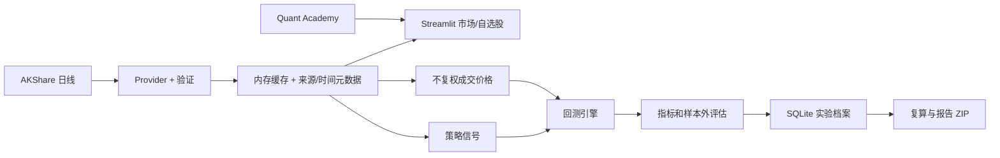

# 架构与数据流

## 模块化单体

| 边界 | 当前模块 | 责任 |
| --- | --- | --- |
| Market Data | `market_data.py`, `data.py`, `refresh.py`, `names.py`, `processing.py` | 代码与名称、日线、查询隔离缓存、并发合并、失败保留及来源元数据 |
| Strategy | `strategy.py` | 用已知收盘价生成目标持仓信号 |
| Backtest | `backtest.py` | 下一开盘模拟成交、费用、滑点、交易限制与订单记录 |
| Analytics | `metrics.py`, `statistics.py`, `portfolio.py`, `research.py` | 风险收益、统计、组合、样本内外实验与指纹 |
| Learning | `learning.py`, `knowledge.py` | 八节参数实验、集中解释、当前数值模板 |
| Storage | `storage.py`, `migrations.py`, `paths.py` | SQLite 版本迁移、备份、自选股、设置、实验和学习笔记 |
| AI | `deepseek.py`, `ai_context.py`, `credentials.py`, `security.py` | 动态模型、限定事实摘要、流式请求、安全凭据和脱敏；原 OpenAI 研究模块仍保留 |
| UI | `ui*.py`, `charts.py`, `app.py` | Streamlit 页面与 Plotly 展示；不实现核心金融公式 |
| Desktop | `desktop_launcher.py`, `QuantLab.spec`, `installer/` | 本地服务、pywebview、PyInstaller 与 Inno Setup |

## 数据合同

`MarketDataProvider.history(market, symbol, start, end, adjustment)` 返回经验证的 `HistoryBundle`：`date/open/high/low/close/volume/amount`、市场、规范代码、来源、币种、复权、接收 UTC 时间和缓存标记。`snapshot` 当前由**最近历史日线收盘**派生，只有行情日期，没有已验证的盘中报价时刻；`received_at` 仅表示本机收到响应的时间。界面标注“历史日线；确切延迟未知”。未来授权适配器应返回独立的报价时间、时区、延迟状态与授权属性，不能把接收时间充当交易所时间。

历史缓存为 15 分钟、最多 64 个查询，快照缓存为 5 分钟；同查询并发合并，返回副本。市场页轮询按 5/10/15 分钟强制检查当前已加载查询和自选股；手动绕过对应缓存，5 秒防抖，不同快照请求至少间隔 1 秒。成功时间来自上游响应；缓存读取不更新它。失败保留旧值和时间并标明可能过期，不用演示值填充。自动更新限运行中的市场页会话。证券名称走独立基础信息服务，缓存 24 小时并持久化到证券资料表。

## 实验复现

回测读取同一交易日的信号价和不复权成交价，按日期严格对齐。信号由收盘形成，下一交易日开盘尝试成交。保存实验时，SQLite 压缩存储两份 CSV 快照和 SHA-256、参数、费用、市场、来源、接收时间、结果与研究笔记。复算从归档输入重新运行并核对实验指纹。ZIP 包含 Markdown 报告、两份行情 CSV 与 `assumptions.json`。

## 桌面与未来演进

桌面版沿用 `desktop_launcher.py` 启动仅监听 `127.0.0.1` 的 Streamlit 服务，pywebview 显示页面。用户数据库、日志、设置和 WebView 缓存都在 `%LOCALAPPDATA%\QuantLabCNHK` 或 `QUANT_LAB_DATA_DIR` 覆盖目录；安装目录可只读。

下一阶段可实现授权报价 Provider（例如 Futu OpenAPI），并补足可验证的报价时间、许可证与限频契约；再评估 FastAPI 作为调用现有 Market Data、Backtest、Storage 服务的薄接口层。当前不需要微服务、React/Tauri 或实盘交易。SQLite schema 变更需版本化迁移，不能删除用户档案后重建。

## 迁移与 AI 边界

`PRAGMA user_version=2` 包含旧实验与自选股、新增名称列、证券资料缓存、非敏感设置及学习笔记。无版本号的旧库先一致性备份，再在 `BEGIN IMMEDIATE` 事务中升级；失败回滚，快照 BLOB 与指纹不重写。

AI 用原生 `st.sidebar`、expander、滚动容器和表单；不会修改 DOM 来实现侧栏。只有表单提交调用对话接口。上下文按白名单从当前 bundle/实验构造，数据指纹或实验变化时不复用旧研究历史；私人笔记与整表不在白名单。模型参数取官方列表能力，未知模型采用必要字段及输出上限。

Key 只存在会话或 Win32 `CredWriteW/CredReadW/CredDeleteW` 管理的本应用凭据中，安全存储故障不会退回文件。异常信息不显示原始响应或带 Key 的传输异常；输出与学习笔记经过脱敏。测试用虚拟凭据和模拟 API；真实 API 最小验证由用户在软件内完成。
