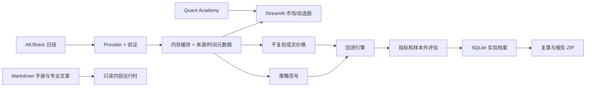

# 架构与数据流

## 模块化单体

| 边界 | 当前模块 | 责任 |
| --- | --- | --- |
| Market Data | `market_data.py`, `data.py`, `refresh.py`, `names.py`, `securities.py`, `processing.py` | 代码与名称、可搜索目录、日线、查询隔离缓存、并发合并、失败保留及来源元数据 |
| Strategy | `strategy.py` | 用已知收盘价生成目标持仓信号 |
| Backtest | `backtest.py` | 下一开盘模拟成交、费用、滑点、交易限制与订单记录 |
| Analytics | `metrics.py`, `statistics.py`, `portfolio.py`, `research.py` | 风险收益、统计、组合、样本内外实验与指纹 |
| Learning | `learning.py`, `knowledge.py`, `guidance.py`, `learning_store.py` | 八节参数实验、七层课程、四条路径、真实指南、任务证据、进度与测验 |
| Manual Content | `manual_content.py`, `docs/knowledge-drafts/` | 只读发现、严格 frontmatter 校验、稳定 ID/分类/关联查询与离线纯文本搜索；不依赖 UI、SQLite 或网络 |
| Storage | `storage.py`, `migrations.py`, `paths.py` | SQLite 版本迁移、备份、自选股、设置、实验和学习笔记 |
| AI | `deepseek.py`, `ai_research.py`, `ai_context.py`, `credentials.py`, `security.py` | 共用 DeepSeek 连接、动态模型、流式问答与 JSON 假设/审阅、限定摘要、安全凭据和脱敏 |
| UI | `ui*.py`, `charts.py`, `app.py` | Streamlit 页面与 Plotly 展示；不实现核心金融公式 |
| Desktop | `desktop_launcher.py`, `QuantLab.spec`, `installer/` | 本地服务、pywebview、PyInstaller 与 Inno Setup |

## 文字手册内容运行时

`manual_content.py` 从源码树或 PyInstaller 的资源根读取 `docs/knowledge-drafts/`，不依赖当前工作目录。它严格要求 10 篇登记手册和 85 篇专业文章，解析文章 frontmatter 与 Markdown 正文，并在启动查询前验证必填字段、软件状态、重复 ID、分类及全部前置/相关文章引用。搜索索引仅由中文标题、英文标题、别名和正文在本地生成，不联网、不写用户资料库，也不导入 Streamlit。

当前只建立内容层，尚未连接 UI。旧 `learning.py`、`guidance.py`、`learning_store.py`、学习表和 schema v4 均保持不变。`QuantLab.spec` 只负责把同一份只读 Markdown 资源带入未来的冻结应用；内容不会复制到用户资料库作为唯一来源。

## 数据合同

`MarketDataProvider.history(market, symbol, start, end, adjustment)` 返回经验证的 `HistoryBundle`：`date/open/high/low/close/volume/amount`、市场、规范代码、来源、币种、复权、接收 UTC 时间和缓存标记。A 股使用 AKShare 腾讯历史接口；港股以东方财富 `stock_hk_hist` 为主链路，传入明确日期区间，网络/API 异常时回退新浪 `stock_hk_daily`，并把回退写入 `source`，不隐藏来源切换。`snapshot` 当前由**最近历史日线收盘**派生，只有行情日期，没有已验证的盘中报价时刻；`received_at` 仅表示本机收到响应的时间。界面标注“历史日线；确切延迟未知”。未来授权适配器应返回独立的报价时间、时区、延迟状态与授权属性，不能把接收时间充当交易所时间。

历史缓存为 15 分钟、最多 64 个查询，快照缓存为 5 分钟；同查询并发合并，返回副本。市场页轮询按 5/10/15 分钟强制检查当前已加载查询和自选股；手动绕过对应缓存，5 秒防抖，不同快照请求至少间隔 1 秒。成功时间来自上游响应；缓存读取不更新它。失败保留旧值和时间并标明可能过期，不用演示值填充。自动更新限运行中的市场页会话。证券名称走独立基础信息服务，缓存 24 小时并持久化到证券资料表。

## 实验复现

回测读取同一交易日的信号价和不复权成交价，按日期严格对齐。信号由收盘形成，下一交易日开盘尝试成交。保存实验时，SQLite 压缩存储两份 CSV 快照和 SHA-256、参数、费用、市场、来源、接收时间、结果与研究笔记。复算从归档输入重新运行并核对实验指纹。ZIP 包含 Markdown 报告、两份行情 CSV 与 `assumptions.json`。

## 桌面与未来演进

桌面版沿用 `desktop_launcher.py` 启动仅监听 `127.0.0.1` 的 Streamlit 服务，pywebview 显示页面。首次启动通过原生目录选择器创建结构化资料库；默认位置只保留非敏感 `bootstrap.json` 指针。数据库、笔记附件、备份、日志、缓存和 WebView 数据进入活动资料根目录；`QUANT_LAB_DATA_DIR` 在测试中覆盖该流程。

V2 构建输出到 `dist/packages/<版本>/QuantLab`，manifest 保存 `payload_dir`，安装器和验收脚本读取同一目录。新版本不会清理正在运行的旧 `dist/QuantLab`；如果相同版本目录已有运行进程，构建预检停止，避免覆盖使用中的 payload。

下一阶段可实现授权报价 Provider（例如 Futu OpenAPI），并补足可验证的报价时间、许可证与限频契约；再评估 FastAPI 作为调用现有 Market Data、Backtest、Storage 服务的薄接口层。当前不需要微服务、React/Tauri 或实盘交易。SQLite schema 变更需版本化迁移，不能删除用户档案后重建。

## 迁移与 AI 边界

`PRAGMA user_version=4` 保留旧实验、行情 BLOB、自选股、名称、非敏感设置和学习记录，新增 `note_categories`、`note_drafts`、`note_attachments` 以及笔记/实验的分类和回收站字段。旧库先一致性备份，再在 `BEGIN IMMEDIATE` 事务中升级；失败回滚，原快照与指纹不重写。

`global_topbar` 固定横跨窗口，并取代左栏中的 AI、新手指引和研究笔记入口。三个独立面板支持 Pointer Events 调宽、三按钮拖拽排序与 FLIP 动画；各面板外壳不滚动，固定头部下的 `*_panel_body` 独立滚动。`left_sidebar_visible` 控制左侧导航栏显示，完全独立于三个右侧面板状态；ResizeObserver 把左栏实测宽度同步到 `--ql-sidebar-width`。最大化时只渲染目标面板并清除主区让位宽度：左栏可见则从左栏右缘开始，左栏隐藏则覆盖完整应用宽度，垂直方向始终限制在全局顶栏下方。非敏感宽度与顺序写入 WebView `localStorage`。`settings_panel` 锚定左上角，集中资料库、Credential Manager、模型与偏好设置。

`notes.py` 负责分类树、草稿、统一笔记/实验检索、回收站、附件验证和 ZIP 导出。附件先写临时文件，再原子改名并记录相对路径、MIME、大小与 SHA-256；图片 `attachment://id` 标记在渲染前从 Markdown 中移除并由受控组件显示，避免浏览器请求未知协议。

股票选择用一个支持 `accept_new_options` 的搜索下拉框，代码和名称候选排序保持原样；未收录代码统一经过 `normalize_symbol`，无效输入禁用加载，市场切换保留各自选择。`securities.py` 提供市场隔离的目录：内置基础资料快照保证离线候选可用，显式更新取得新目录后原子写入 `user_data_dir()/securities/`。每份目录校验市场、规范代码、名称冲突、来源和带时区接收时间；失败保留原值。目录没有价格、币种换算或买入意见，名称字段不用于证明上市/可交易。`names.py` 独立查询东方财富基础资料，24 小时成功缓存、5 分钟失败冷却，手动名称更新绕过缓存且合并同查询并发，失败保留名称与原成功时间；不改写存档实验。

Key 只存在会话或 Win32 `CredWriteW/CredReadW/CredDeleteW` 管理的本应用凭据中；新会话在创建任何 Key 控件前自动执行一次 `CredReadW` 恢复。安全存储故障不会退回文件。异常信息不显示原始响应或带 Key 的传输异常；输出与学习笔记经过脱敏。测试用虚拟凭据和模拟 API；真实 API 最小验证由用户在软件内完成。

## V2 导航与教学

`ui_guidance.py` 使用原生 Streamlit 回调，把九页指南映射到稳定导航，保护研究控件 key，返回帮助前的研究页；不使用 DOM 修改或第二套聊天栏。首次欢迎不替换原市场页，可以跳过和重启。新手/专业模式复用 `learning_mode`，不进入金融参数。

自动任务仅记录应用成功动作及来源/指纹：选择身份、非演示有效日线、预热后的策略信号、成功回测、带判断的实验保存。纯解释步骤记录用户确认。课程必须保存教学实验并通过本地测验才算完成，查看课程或路径不自动完成。会话进度缓存按用户数据库路径隔离，只有学习动作写入；指南和路径不联网抓新数据。

统计与 AI 实验页面现在提供实际模型/审计摘要；课程与指南提供类型明确的教学上下文。DeepSeek 研究/教学模式仍走同一客户端；白名单增加 `statistics`、`learning_context` 和 `answer_mode`，显式过滤练习答案、目标、笔记等。对话作用域涵盖数据、实验、课程/指南、教学参数、统计评价与回答模式，知识追问跨页携带点击时的白名单摘要并显示来源；更换查询或离开 AI 页后清除携带摘要。

AI 页暂时隐藏的密钥、模型和草稿控件使用显式会话保留，防止 Streamlit 页面切换清理；不把按钮状态加入保留集合。密钥仍只在内存或 Windows 凭据管理器中。
